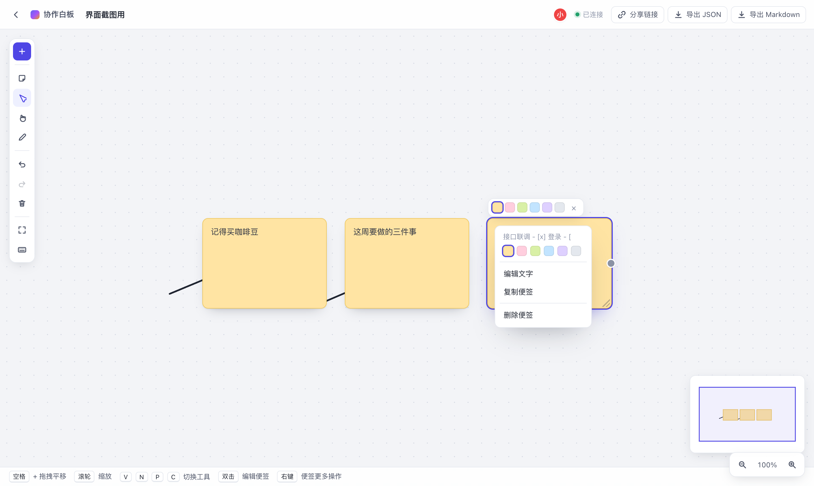
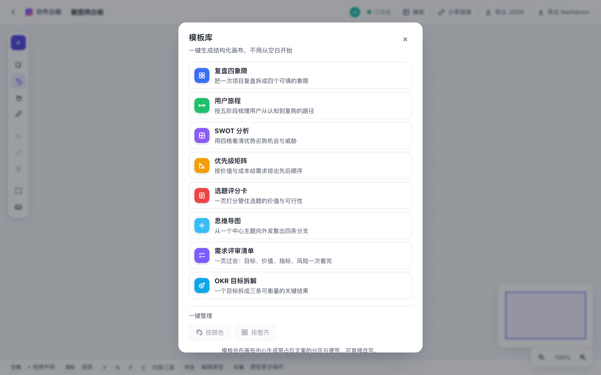
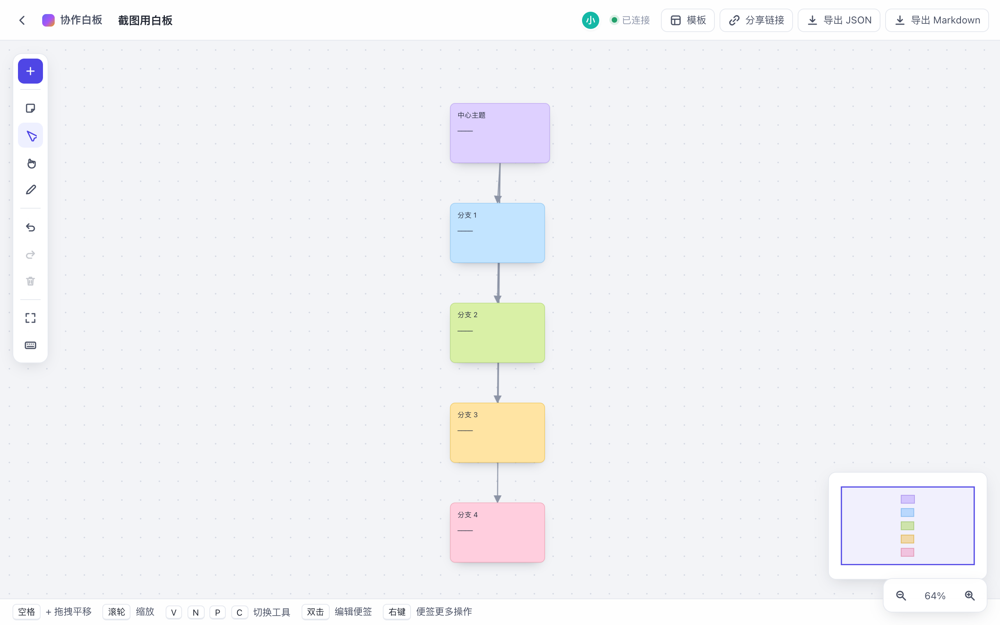

# 协作白板 · 团队便签

团队内部使用的多人协作便签白板。用来整理工作、记录待办、规划产品逻辑。

- **真·实时同步**：Node + WebSocket 服务端，多人同时编辑同一块白板，改动即时到达
- **光标可见**：能看到队友的名字和鼠标位置，不会互相"看不见地"覆盖
- **无限画布**：平移、缩放、便签自由拖拽、缩放大小、箭头连线
- **Miro 式画布手感**：滚轮直接缩放、空格 + 拖拽平移、`V`/`N`/`P`/`C` 切换工具、右键便签出菜单
- **自由画笔**：可以直接在画布上画线，笔画同样实时同步并落盘
- **右下角缩略图**：一眼看到整块白板的全貌，点一下就能跳过去
- **开箱即用的视野**：进入白板自动缩放到能看见所有便签；新建便签自动避开已有便签，不会叠成一摞
- **轻量待办**：便签里写 `- [ ] xxx` 就是可勾选的待办项，勾选状态实时同步
- **免注册**：昵称 + 白板口令即可进入，口令只存在你自己的服务器上
- **一次输入，12 小时免密**：验证口令后发放会话令牌，刷新页面、换浏览器、服务重启都不用再输
- **自动保存**：内容实时写入本地 JSON 文件，刷新、换人、重启都不丢

---

## 快速开始

```bash
cd team-sticky-board
npm install
npm run dev          # 开发模式：前端 5173，后端 8787
```

打开 <http://localhost:5173>，创建白板 → 把链接发给同事 → 一起写。

生产模式（单端口，前端由后端托管）：

```bash
npm run build
npm start            # http://localhost:8787
```

## 常用命令

| 命令 | 说明 |
| --- | --- |
| `npm run dev` | 同时启动后端与 Vite 开发服务器（带热更新） |
| `npm run build` | 构建前端到 `dist/client` |
| `npm start` | 启动服务，同时托管前端与 WebSocket |
| `npm run typecheck` | TypeScript 类型检查 |
| `npm run selftest` | 端到端自测（需先启动服务）：口令校验、令牌免密重连、同步、落盘、删板鉴权 |
| `npm run test:export` | 导出逻辑自测（Markdown / JSON） |
| `npm run test:placement` | 便签落位自测（连续新建不重叠） |
| `npm run test:ui` | 真实浏览器 UI 回归（需先启动服务）：工具切换、滚轮缩放、空格平移、画笔、右键菜单、缩略图、双端同步，共 49 项 |
| `bash scripts/install-service.sh` | 注册为 macOS 开机自启后台服务（内网部署用） |
| `bash scripts/uninstall-service.sh` | 取消开机自启（白板数据保留） |
| `bash scripts/lan-address.sh` | 打印同事该用的内网地址 + 服务健康检查 |
| `bash scripts/backup.sh` | 备份白板数据到 `backups/` |
| `node scripts/spread-overlaps.mjs` | 一次性修复：把旧数据里重叠在一起的便签错开摆好（需先停服务） |

### HTTP 接口

| 方法 | 路径 | 说明 |
| --- | --- | --- |
| `GET` | `/api/boards` | 白板列表（标题、便签数、是否有口令） |
| `GET` | `/api/boards/:id` | 白板基本信息 |
| `POST` | `/api/boards` | 新建白板，body `{title, password}` |
| `DELETE` | `/api/boards/:id` | 删除白板；白板有口令时 body 需带正确的 `password` |

```bash
# 删掉一块不要的白板（有口令的必须带对口令，否则返回 403）
curl -X DELETE http://localhost:8787/api/boards/<boardId> \
  -H 'Content-Type: application/json' -d '{"password":"<口令>"}'
```

## 给团队部署到内网

### 一键注册为开机自启服务（macOS）

```bash
bash scripts/install-service.sh
```

它会做三件事：停掉手工启动的旧进程、把服务注册进 `launchd`（开机自启 + 崩溃自动拉起）、用 `caffeinate` 包一层防止电脑空闲休眠导致服务掉线。

装完把下面这个链接发给同事：

```bash
bash scripts/lan-address.sh     # 打印同事该用的地址 + 服务健康检查
```

当前这台机器是 `http://10.0.0.13:8787`。IP 由路由器分配，可能会变——建议在路由器上给这台机器做 **IP 保留**，或者每次发链接前跑一次上面那条命令确认。

### 手边要知道的几个坑

| 事项 | 说明 |
| --- | --- |
| **合盖会断** | 服务只防"空闲休眠"。笔记本合盖/拔电源仍会睡眠，唤醒后服务自动恢复（launchd 会拉起），但这期间同事连不上 |
| **防火墙** | macOS 防火墙需允许 node 接受传入连接。`/opt/homebrew/bin/node` 已在允许列表里；若换过 Node 路径，在「系统设置 → 网络 → 防火墙」里补一下 |
| **换端口** | `PORT=8080 bash scripts/install-service.sh`，重启后生效 |
| **换 IP / 换网络** | 重新跑 `scripts/lan-address.sh` 拿新地址 |

### 白板数据与备份

数据全在本机，**不上传任何第三方**：

```
data/boards/*.json     每块白板一个文件
data/sessions.json     会话令牌的哈希
data/server.log        服务日志
```

```bash
bash scripts/backup.sh            # 备份到 backups/board-backup-<时间戳>/
bash scripts/uninstall-service.sh # 取消开机自启（数据保留）
```

> 口令是团队内部约定，不是账号体系。想更强管控可以放到 Nginx 后面加一层 Basic Auth。

## 身份与安全

| 机制 | 说明 |
| --- | --- |
| 白板口令 | 只存 `sha256(盐:口令)`，明文口令不落盘；口令仅用于"能不能进这块板" |
| 会话令牌 | 验证口令后签发，12 小时有效；浏览器存 sessionStorage，刷新免密 |
| 令牌落盘 | 服务端只把令牌的哈希写进 `data/sessions.json`，所以重启服务队友也不用重输口令 |
| 删板鉴权 | `DELETE /api/boards/:id` 在白板有口令时必须校验口令，避免误删或被他人清空 |

## 视野与落位

- **进入白板自动适应全部便签**：画布初始视口不再写死，便签铺得再开也一眼看全（再按 `F` 可手动重算）
- **新建便签自动避让**：新便签若和已有便签重叠，会在周围找一块完全空的位置摆好，不会叠成一摞只剩最后一张
- **双击画布**按点击位置新建，**按 `N`** 则落在当前视口中心附近

## 功能速查

### 便签

| 操作 | 方式 |
| --- | --- |
| 新建 | 画布空白处**双击**，或按 `N`，或点左侧 ➕ |
| 编辑 | 双击便签，或选中后按 `Enter` |
| 移动 | 拖拽便签（**新建的便签默认在编辑态，按 `Esc` 或点画布空白处退出编辑后即可拖动**） |
| 改大小 | 拖拽便签右下角 |
| 换色 | 选中后点便签上方的色块，或**右键便签**在菜单里选颜色 |
| 删除 | 选中后按 `Delete`，或点便签右上角 ×，或**右键便签 → 删除便签** |
| 复制 | 选中后按 `⌘D`，或**右键便签 → 复制便签**（副本会自动摆到旁边，不会压在原便签上） |
| 更多 | **右键便签**打开菜单：换颜色 / 编辑文字 / 复制便签 / 删除便签 |

### 便签正文语法

```
# 标题
- 列表项
- [ ] 待办（点击方框可勾选，状态会同步）
- [x] 已完成
> 引用
**加粗**  `行内代码`
```

### 连线（画产品流程图）

把鼠标移到便签上，右侧会出现一个圆点，按住圆点拖到另一张便签上松开，就建立了一条带箭头的连线。点击连线选中后按 `Delete` 删除。

### 工具栏（画布操作）

左侧竖排工具栏，按 `V` / `N` / `P` / `C` 也可以直接切。**当前处于哪个工具，对应按钮就是高亮的；再点一次同一个按钮就取消选择、回到选择工具**（`P` / `C` 按键同样支持"再按一次取消"）。

| 工具 | 键位 | 作用 |
| --- | --- | --- |
| 选择 | `V` | 选便签、拖便签；空白处拖拽 = 平移画布 |
| 便签 | `N` / 便签按钮 | 在点击处新建便签 |
| 抓手 | `P` | 任何位置拖拽都是平移画布 |
| 画笔 | `C` | 自由画线，笔画会实时同步给队友 |

工具栏第一个 ➕ 是**快捷新建**：在当前视口中心建一张便签并直接进入编辑。

### 自由画笔

按 `C`（或点工具栏的笔）后在画布上按住拖动即可画线。笔画和其它内容一样走同一条同步链路：对手立刻看到，你也能用 `⌘Z` 撤销。画笔不会画到便签上，避免误触。

### 缩略图

右下角是整块白板的缩略图：黄色块是便签，细线是笔画，蓝框是当前视野。点缩略图的任意位置就能把视野跳过去，适合白板摊得很大的时候定位。



### 模板库

顶栏的「模板」按钮打开模板库，点一下就在**画布中心**生成一组带占位文案的分区与便签（含连线），直接改写就行，不用从空白开始：

| 模板 | 生成什么 |
| --- | --- |
| 复盘四象限 | 四个象限：做得好 / 做得不好 / 意外收获 / 下次改进 |
| 用户旅程 | 认知 → 考虑 → 购买 → 使用 → 复购 五阶段带箭头 |
| SWOT 分析 | 优势 / 劣势 / 机会 / 威胁 四格 |
| 优先级矩阵 | 按价值 × 成本分成四个象限 |
| 选题评分卡 | 价值 / 成本 / 风险 / 排期 四项打分 + 总分结论 |
| 思维导图 | 一个中心主题向外发散四条分支 |
| 需求评审清单 | 需求、目标用户、核心价值、衡量指标、上线风险、结论 |
| OKR 目标拆解 | 一个 O 拆成三条 KR |

模板走的是普通操作，所以**队友会同步看到**，刷新也不会丢；`⌘Z` 可以一步步撤掉。



### 一键整理

模板库底部有两个整理按钮，会一次性把所有便签重新排布：

- **按颜色**：同一种颜色的便签排成一行，不同颜色分行
- **排整齐**：所有便签按层叠顺序排成等距网格

整个动作**只算一步撤销**（按一次 `⌘Z` 就回到整理前），也会同步给队友。



### 快捷键

| 快捷键 | 功能 |
| --- | --- |
| `V` / `N` / `P` / `C` | 切换 选择 / 便签 / 抓手 / 画笔 工具（再按一次同一个键 = 取消选择，回到选择工具） |
| `N` | 新建便签（落在当前视口中心附近） |
| `Enter` | 编辑选中便签 |
| `Delete` | 删除选中便签/连线 |
| `⌘Z` / `⇧⌘Z` | 撤销 / 重做 |
| `⌘D` | 复制便签 |
| `F` | 适应内容 |
| **滚轮** | **以鼠标位置为中心缩放**（`⌘ + 滚轮` 同样是缩放） |
| **Shift + 滚轮** | **横向平移画布** |
| **空格 + 拖拽** | **临时平移画布**（松手即恢复原工具） |
| 拖拽空白处 | 平移画布（选择工具下） |
| 双击便签 | 编辑便签 |
| 右键便签 | 打开便签菜单（换色 / 编辑 / 复制 / 删除） |
| `Esc` | 取消选择 / 退出便签编辑 |

### 导出

顶栏「导出 JSON」导出完整数据（含坐标与连线），「导出 Markdown」导出可读的待办清单。

### 分享给同事

白板顶栏的「分享链接」会复制**内网地址**的链接（不是 `localhost`，同事打不开）：

```
http://10.0.0.13:8787/#/b/<白板id>
```

同事打开后填昵称 + 白板口令即可加入，口令单独发给他们。链接里不带口令，别人即使拿到链接也进不去。

## 技术结构

```
team-sticky-board/
├── server/
│   ├── index.js          HTTP + WebSocket 服务、房间管理、静态托管
│   └── store.js          白板持久化、口令哈希、操作应用
├── src/
│   ├── lib/
│   │   ├── connection.ts WebSocket 客户端（自动重连）
│   │   ├── store.ts      白板状态仓库（操作应用、撤销栈）
│   │   ├── boardContext.ts 画布上下文（视图、选中、编辑态、当前工具、空格键）
│   │   ├── noteText.tsx  便签极简 Markdown 解析
│   │   ├── placement.ts  便签落位（避开已有便签，防止互相盖住）
│   │   ├── templates.ts  内置模板库（模板定义）
│   │   ├── layout.ts     一键整理的排布算法（按颜色 / 网格）
│   │   └── exportBoard.ts 导出 JSON / Markdown
│   ├── components/
│   │   ├── Home.tsx      首页（白板列表）
│   │   ├── BoardSession.tsx 加入页（昵称 + 口令）
│   │   ├── Board.tsx     画布主体（工具状态、滚轮缩放、空格平移、指针分派）
│   │   ├── Chrome.tsx    顶栏 / 工具栏 / 缩放控件 / 快捷键说明面板
│   │   ├── NoteCard.tsx  便签（拖拽、缩放、编辑、右键菜单）
│   │   ├── ContextMenu.tsx 便签右键菜单（换色 / 编辑 / 复制 / 删除）
│   │   ├── TemplateLibrary.tsx 模板库面板（套模板 + 一键整理）
│   │   ├── Minimap.tsx   右下角缩略图（便签、笔画、视野框，点击跳转）
│   │   ├── ShortcutBar.tsx 底部快捷键提示条
│   │   ├── StrokeLayer.tsx  自由画笔的 SVG 笔画层
│   │   ├── EdgeLayer.tsx    连线层
│   │   └── CursorLayer.tsx  队友光标层
│   └── styles.css        全部样式
├── scripts/
│   ├── dev.mjs           同时拉起前后端
│   ├── selftest.mjs      端到端自测（19 项）
│   ├── test-export.mjs   导出自测（8 项）
│   ├── test-placement.mjs 便签落位自测（5 项）
│   ├── verify-ui.mjs     真实浏览器 UI 回归（49 项）
│   ├── screenshot.mjs    生成新界面截图到 docs/（临时白板，截完即删）
│   ├── screenshot-templates.mjs 生成模板库相关截图到 docs/
│   ├── mock-user.mjs     模拟第二个用户（联调/演示用）
│   ├── install-service.sh / uninstall-service.sh  开机自启服务（内网部署）
│   ├── lan-address.sh    打印内网访问地址
│   └── backup.sh         备份白板数据
├── docs/
│   ├── screenshot-new-ui.png          新界面截图（工具栏 / 右键菜单 / 缩略图 / 快捷键条）
│   ├── screenshot-template-library.png 模板库面板
│   ├── screenshot-template-applied.png 套用模板后的画布
│   └── screenshot-template-tidy.png    一键整理后的画布
├── data/
│   ├── boards/*.json     白板数据（自动创建）
│   └── sessions.json     会话令牌的哈希（可删，删后队友需重输一次口令）
```

### 同步模型

所有改动都表达为**操作（op）**：`note.create` / `note.update` / `note.delete` / `edge.create` / `edge.delete` / `stroke.create` / `stroke.delete` / `notes.layout`（一键整理） / `board.update`。

- 客户端本地立即生效（乐观更新），同时把 op 发给服务端
- 服务端按到达顺序应用到权威状态，并**按同一顺序广播**给房间内所有人
- 所有端按同一顺序应用 → 最终状态一致，不会出现"谁覆盖谁"
- 正在被本地拖拽的便签，会忽略远端的位置补丁，避免画面跳动
- 服务端每 400ms 合并写盘一次，重启不丢数据
